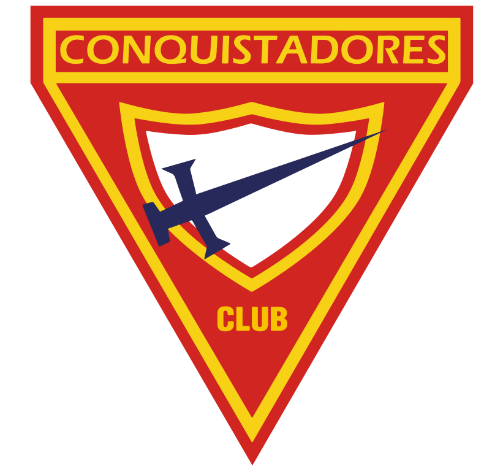

# Guías para resolver especialidades

**Club de Conquistadores — División Sudamericana**

---

Requisitos extraídos del Manual DSA 2013 con respuestas investigadas para Conquistadores (10-16 años). Dos formas de acceder:

- **[📖 Guías de Instrucción](./especialidades/)** — Para instructores que necesitan aprender a enseñar las especialidades
- **[✅ Respuestas para Evaluación](./jvargas/)** — Para Regionales e Instructores al evaluar Guías Mayores y Conquistadores

Las guías disponibles desarrollan actividades, secuencias de aprendizaje o instrucciones prácticas para conducir la especialidad. Los cuestionarios resueltos se consultan en la sección de respuestas para evaluación.

---

## 🏕️ Actividades Recreativas (AR) — 6 guías

- [Arte de acampar](./especialidades/AR/arte_de_acampar.md) (AR-001)
- [Campamento I](./especialidades/AR/campamento_i.md) (AR-049)
- [Campamento II](./especialidades/AR/campamento_ii.md) (AR-050)
- [Campamento III](./especialidades/AR/campamento_iii.md) (AR-051)
- [Campamento IV](./especialidades/AR/campamento_iv.md) (AR-053)
- [Nudos y amarras](./especialidades/AR/nudos_y_amarras.md) (AR-040)

## 🌳 Estudio de la Naturaleza (EN) — 2 guías

- [Cactus](./especialidades/EN/cactus.md) (EN-015)
- [Flores](./especialidades/EN/flores.md) (EN-005)

## 🎨 Artes y Actividades Manuales (AM) — 1 guía

- [Temperancia](./especialidades/AM/temperancia.md) (AM-012)

---

## Fuentes

- **Manual DSA 2013** — Fuente oficial de requisitos (División Sudamericana)
- **Manuales GO!** — Material complementario (División Peruana)
- [Pathfinders Online Wiki](https://wiki.pathfindersonline.org/) · [MundoJA](https://mundoja.org/) · [Conquismania](https://www.conquismania.cl/)

---

*Manual de Especialidades — Club de Conquistadores*
*División Sudamericana*

