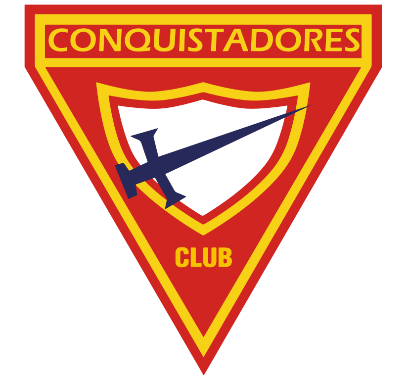

# Guías de Instrucción
## Especialidades del Club de Conquistadores

---

## 🎯 Propósito de esta sección

Esta sección contiene **guías de aprendizaje e instrucción** diseñadas para **instructores nuevos** que necesitan:

- 📖 **Aprender** cómo impartir las especialidades
- 🎓 **Comprender** el contenido pedagógico de cada especialidad
- 🔧 **Prepararse** metodológicamente para enseñar
- 💡 **Desarrollar** habilidades de instrucción

Se incluyen materiales con actividades, secuencias de aprendizaje o instrucciones prácticas para conducir la especialidad. Los cuestionarios resueltos se consultan en la sección de respuestas para evaluación.

### ✨ Optimizado para lectura móvil
✅ Diseño responsive y táctil  
✅ Navegación fácil y rápida  
✅ Modo oscuro automático  
✅ Índice de contenido flotante  

---

> **💡 ¿Buscas respuestas completas para evaluación?**  
> Revisa la sección [**Respuestas para Evaluación**](../jvargas/) con contenido preparado para ser revisado por Regionales e Instructores.

---

## 📚 Especialidades por Área

🏕️ Actividades Recreativas (AR) - 6 guías

- [Arte de acampar](./AR/arte_de_acampar.md) (AR-001)
- [Campamento I](./AR/campamento_i.md) (AR-049)
- [Campamento II](./AR/campamento_ii.md) (AR-050)
- [Campamento III](./AR/campamento_iii.md) (AR-051)
- [Campamento IV](./AR/campamento_iv.md) (AR-053)
- [Nudos y amarras](./AR/nudos_y_amarras.md) (AR-040)

🌳 Estudio de la Naturaleza (EN) - 2 guías

- [Cactus](./EN/cactus.md) (EN-015)
- [Flores](./EN/flores.md) (EN-005)

🎨 Artes y Actividades Manuales (AM) - 1 guía

- [Temperancia](./AM/temperancia.md) (AM-012)

---

## 📖 Fuentes

**Manuales oficiales:**
- **Manual DSA 2013** - Fuente oficial de requisitos (División Sudamericana)
- **Manuales GO!** - Material complementario (División Peruana)

**Recursos web:**
- [Pathfinders Online Wiki](https://wiki.pathfindersonline.org/)
- [MundoJA](https://mundoja.org/)
- [Conquismania](https://www.conquismania.cl/)

---

*Guías de Instrucción - Club de Conquistadores*  
*División Sudamericana*

[← Volver al inicio](../) | [Ver Respuestas para Evaluación →](../jvargas/)

